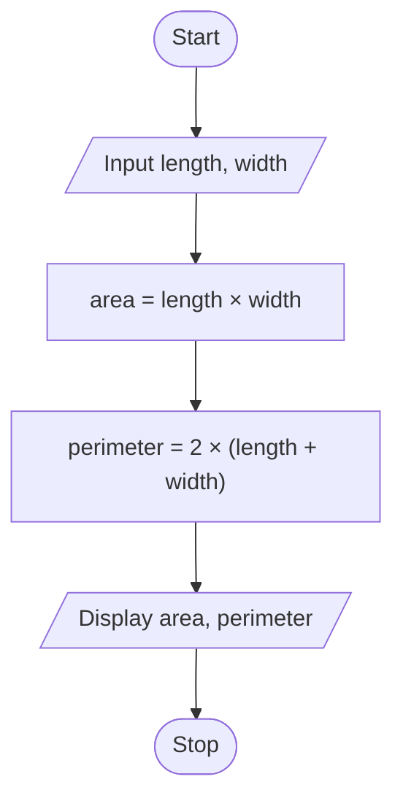

# P1.1: Area and perimeter of a room

**Problem:** Input the length and width of a room in feet. Find and display its area and perimeter.

## Algorithm

1. Start
2. Input Length and Width
3. Area = Length × Width
4. Perimeter = 2 × (Length + Width)
5. Display Area and Perimeter
6. Stop

## Pseudocode

```
BEGIN
    INPUT length, width
    SET area ← length × width
    SET perimeter ← 2 × (length + width)
    PRINT area, perimeter
END
```

## Flowchart



## Dry run

Length = 12, Width = 10: Area = 120 square feet, Perimeter = 44 feet.
