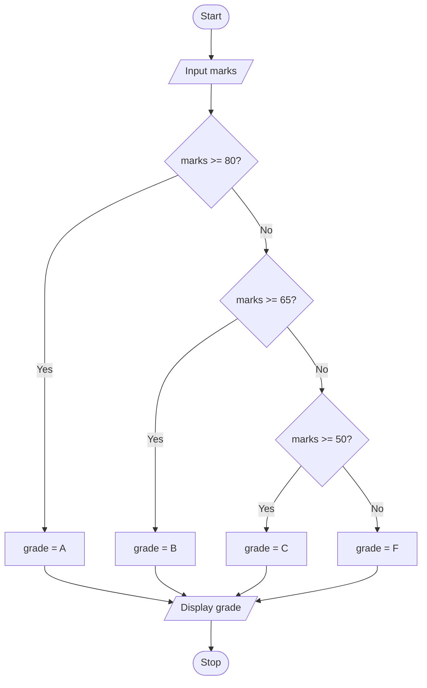

# P1.10: Grade from marks

**Problem:** Input marks out of 100 and display the grade: 80 and above "A", 65 to 79 "B", 50 to 64 "C", below 50 "F".

## Algorithm

1. Start
2. Input Marks
3. If Marks >= 80, Grade = "A"
4. Otherwise, if Marks >= 65, Grade = "B"
5. Otherwise, if Marks >= 50, Grade = "C"
6. Otherwise Grade = "F"
7. Display Grade
8. Stop

## Pseudocode

```
BEGIN
    INPUT marks
    IF marks >= 80 THEN
        SET grade ← "A"
    ELSE
        IF marks >= 65 THEN
            SET grade ← "B"
        ELSE
            IF marks >= 50 THEN
                SET grade ← "C"
            ELSE
                SET grade ← "F"
            ENDIF
        ENDIF
    ENDIF
    PRINT grade
END
```

## Flowchart



## Dry run

Marks = 72: 72 >= 80 is false, 72 >= 65 is true, so grade B.
