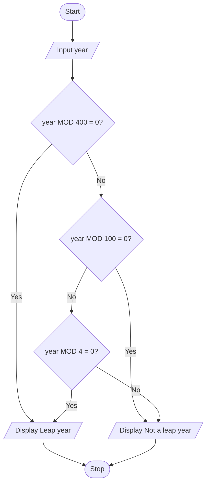

# P1.11: Leap year

**Problem:** Input a year and display whether it is a leap year. A year is a leap year if it is divisible by 4 but not by 100, or if it is divisible by 400.

## Algorithm

1. Start
2. Input Year
3. If (Year MOD 4 = 0 AND Year MOD 100 is not 0) OR Year MOD 400 = 0, display "Leap year"
4. Otherwise display "Not a leap year"
5. Stop

## Pseudocode

```
BEGIN
    INPUT year
    IF (year MOD 4 = 0 AND year MOD 100 <> 0) OR year MOD 400 = 0 THEN
        PRINT "Leap year"
    ELSE
        PRINT "Not a leap year"
    ENDIF
END
```

## Flowchart



## Dry run

2024: not divisible by 400 or 100, divisible by 4, so leap year. 1900: divisible by 100 but not 400, so not a leap year. 2000: divisible by 400, so leap year.
