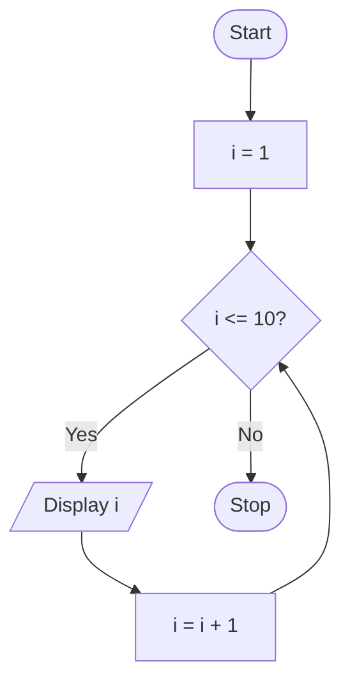

# P1.12: Numbers from 1 to 10

**Problem:** Display the numbers from 1 to 10.

## Algorithm

1. Start
2. I = 1
3. While I <= 10, repeat steps 4 and 5
4. Display I
5. I = I + 1
6. Stop

## Pseudocode

```
BEGIN
    SET i ← 1
    WHILE i <= 10 DO
        PRINT i
        SET i ← i + 1
    ENDWHILE
END
```

## Flowchart



## Dry run

i takes the values 1, 2, ..., 10, each is displayed; when i becomes 11 the condition is false and the loop ends.
