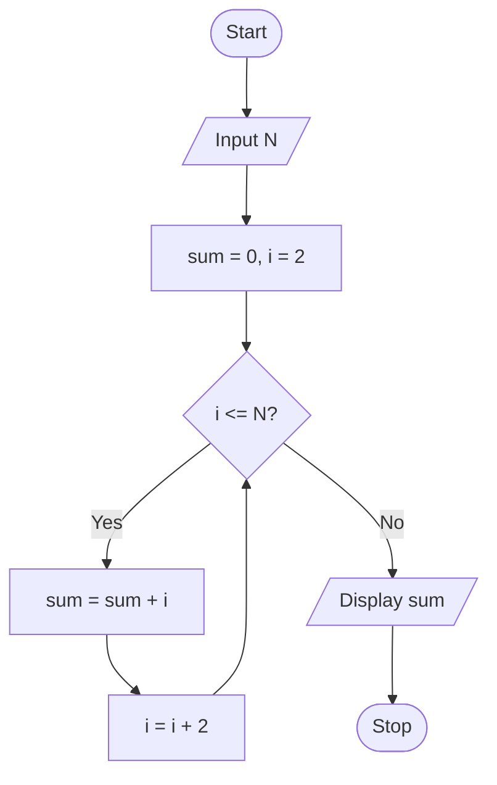

# P1.13: Sum of even numbers

**Problem:** Input N and display the sum of all even numbers from 1 to N.

## Algorithm

1. Start
2. Input N
3. Sum = 0, I = 2
4. While I <= N, repeat steps 5 and 6
5. Sum = Sum + I
6. I = I + 2
7. Display Sum
8. Stop

## Pseudocode

```
BEGIN
    INPUT n
    SET sum ← 0
    SET i ← 2
    WHILE i <= n DO
        SET sum ← sum + i
        SET i ← i + 2
    ENDWHILE
    PRINT sum
END
```

## Flowchart



## Dry run

N = 10: sum = 2 + 4 + 6 + 8 + 10 = 30.
