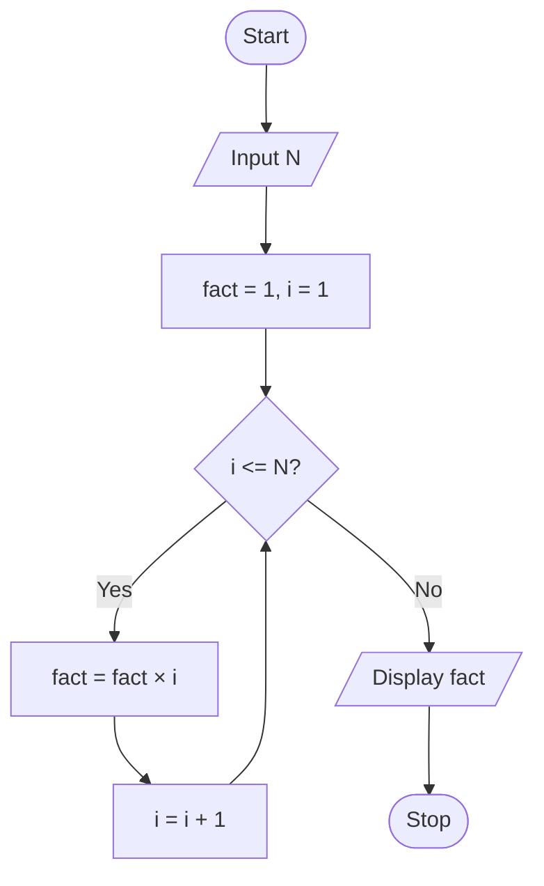

# P1.14: Factorial

**Problem:** Input a number and display its factorial. For example, 5! = 5 × 4 × 3 × 2 × 1 = 120.

## Algorithm

1. Start
2. Input N
3. Fact = 1, I = 1
4. While I <= N, repeat steps 5 and 6
5. Fact = Fact × I
6. I = I + 1
7. Display Fact
8. Stop

## Pseudocode

```
BEGIN
    INPUT n
    SET fact ← 1
    FOR i ← 1 TO n
        SET fact ← fact × i
    ENDFOR
    PRINT fact
END
```

## Flowchart



## Dry run

N = 5: fact = 1, 1, 2, 6, 24, 120. Output: 120. For N = 0 the loop does not run and 0! = 1 is displayed, which is correct.
