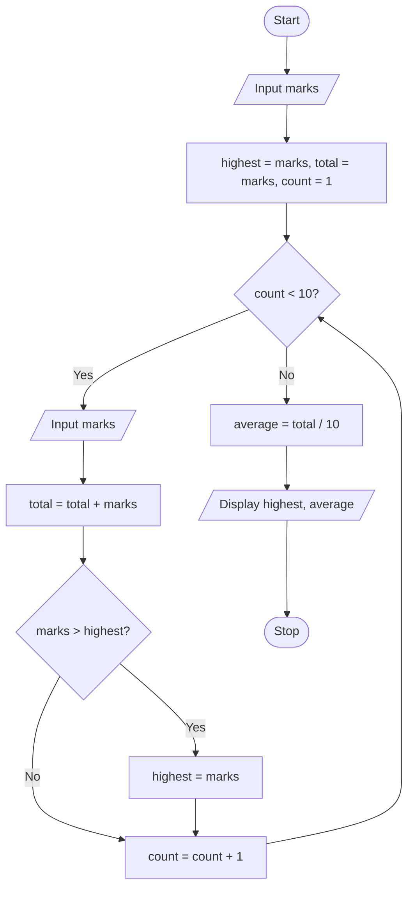

# P1.15: Highest marks and class average

**Problem:** Input marks of 10 students one by one. Display the highest marks and the class average.

## Algorithm

1. Start
2. Input Marks of the first student
3. Highest = Marks, Total = Marks, Count = 1
4. While Count < 10, repeat steps 5 to 7
5. Input Marks
6. Total = Total + Marks
7. If Marks > Highest, Highest = Marks; Count = Count + 1
8. Average = Total / 10
9. Display Highest and Average
10. Stop

## Pseudocode

```
BEGIN
    INPUT marks
    SET highest ← marks
    SET total ← marks
    FOR count ← 2 TO 10
        INPUT marks
        SET total ← total + marks
        IF marks > highest THEN
            SET highest ← marks
        ENDIF
    ENDFOR
    SET average ← total / 10
    PRINT highest, average
END
```

## Flowchart



## Dry run

Marks 72, 85, 64, 90, 55, 78, 81, 69, 47, 88: total = 729, highest = 90, average = 72.9.

The first marks are used to start `highest`, so the solution also works when all marks are low.
