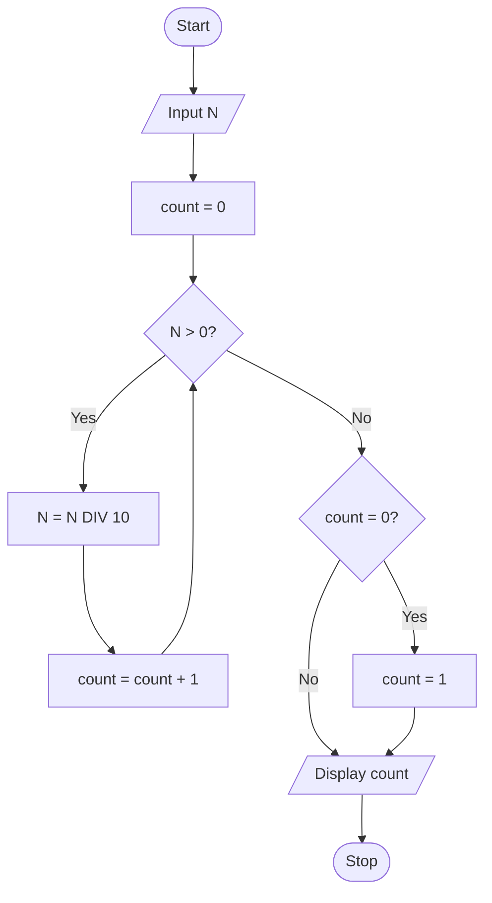

# P1.16: Counting digits

**Problem:** Input a number and count how many digits it has. For example, 4072 has 4 digits.

## Algorithm

1. Start
2. Input N
3. Count = 0
4. Repeat steps 5 and 6 while N > 0
5. N = N / 10 (whole number division, the last digit is removed)
6. Count = Count + 1
7. If Count = 0 (the number was 0), Count = 1
8. Display Count
9. Stop

## Pseudocode

```
BEGIN
    INPUT n
    SET count ← 0
    WHILE n > 0 DO
        SET n ← n DIV 10
        SET count ← count + 1
    ENDWHILE
    IF count = 0 THEN
        SET count ← 1
    ENDIF
    PRINT count
END
```

## Flowchart



## Dry run

N = 4072: 407 (count 1), 40 (count 2), 4 (count 3), 0 (count 4). Output: 4. DIV means division that keeps only the whole number part. The number 0 has one digit, which is why the check after the loop is needed. For a negative number, make it positive first.
