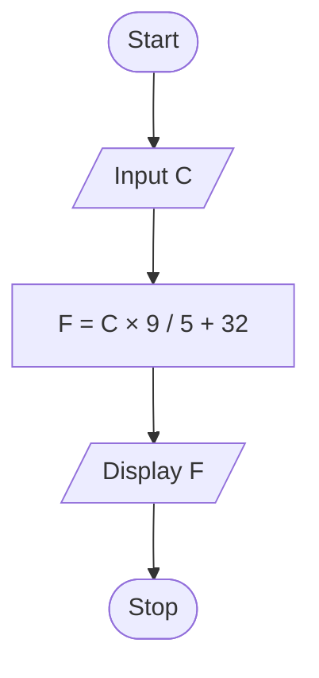

# P1.2: Celsius to Fahrenheit

**Problem:** Input a temperature in Celsius and convert it to Fahrenheit using F = C × 9/5 + 32.

## Algorithm

1. Start
2. Input C
3. F = C × 9 / 5 + 32
4. Display F
5. Stop

## Pseudocode

```
BEGIN
    INPUT c
    SET f ← c × 9 / 5 + 32
    PRINT f
END
```

## Flowchart



## Dry run

C = 37: F = 37 × 9 / 5 + 32 = 66.6 + 32 = 98.6.
