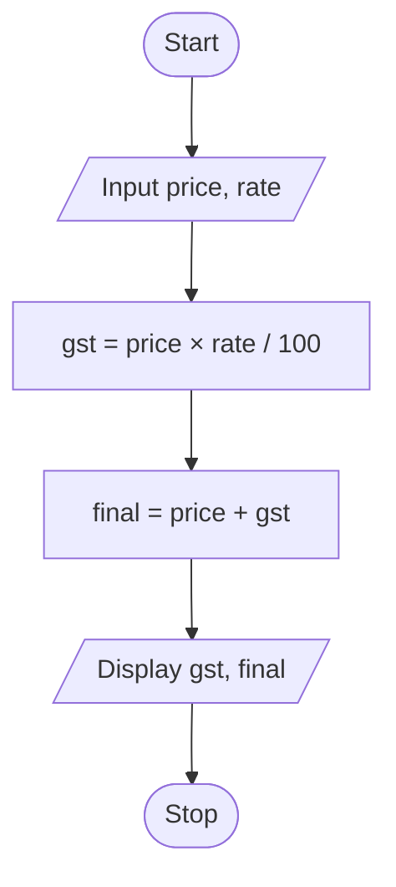

# P1.3: GST on a mobile phone

**Problem:** Input the price of a mobile phone and the GST rate in percent. Display the GST amount and the final price.

## Algorithm

1. Start
2. Input Price and Rate
3. GST = Price × Rate / 100
4. Final = Price + GST
5. Display GST and Final
6. Stop

## Pseudocode

```
BEGIN
    INPUT price, rate
    SET gst ← price × rate / 100
    SET final ← price + gst
    PRINT gst, final
END
```

## Flowchart



## Dry run

Price = Rs. 40000, Rate = 18 (a practice rate): GST = Rs. 7200, Final price = Rs. 47200.
