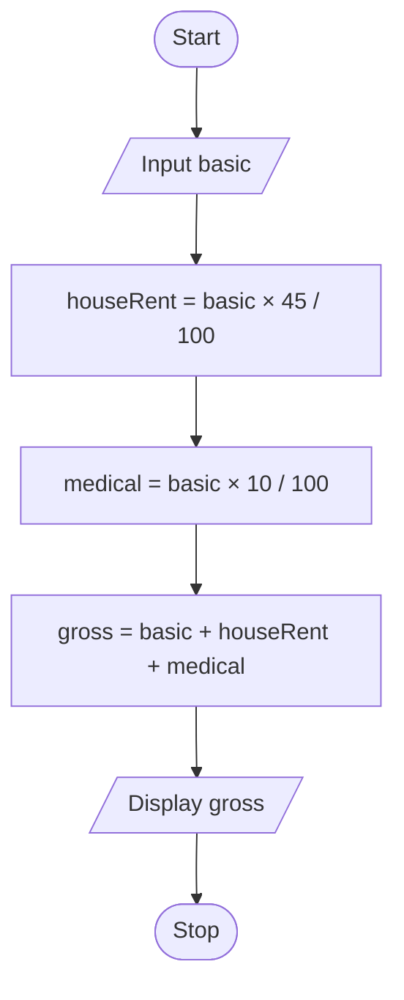

# P1.4: Gross salary

**Problem:** Input the basic salary of an employee. House rent is 45% and medical allowance is 10% of basic salary. Display the gross salary.

## Algorithm

1. Start
2. Input Basic
3. HouseRent = Basic × 45 / 100
4. Medical = Basic × 10 / 100
5. Gross = Basic + HouseRent + Medical
6. Display Gross
7. Stop

## Pseudocode

```
BEGIN
    INPUT basic
    SET houseRent ← basic × 45 / 100
    SET medical ← basic × 10 / 100
    SET gross ← basic + houseRent + medical
    PRINT gross
END
```

## Flowchart



## Dry run

Basic = Rs. 40000: House rent = Rs. 18000, Medical = Rs. 4000, Gross = Rs. 62000.
