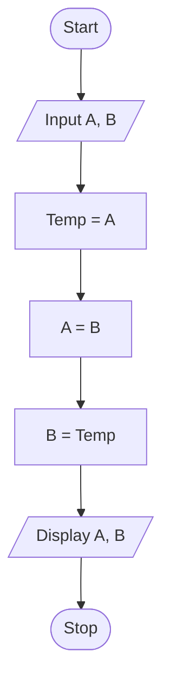

# P1.5: Swapping two numbers

**Problem:** Input two numbers in A and B. Swap their values using a third variable and display them.

## Algorithm

1. Start
2. Input A and B
3. Temp = A
4. A = B
5. B = Temp
6. Display A and B
7. Stop

## Pseudocode

```
BEGIN
    INPUT a, b
    SET temp ← a
    SET a ← b
    SET b ← temp
    PRINT a, b
END
```

## Flowchart



## Dry run

A = 5, B = 9: Temp = 5, A = 9, B = 5. Output: A = 9, B = 5.
