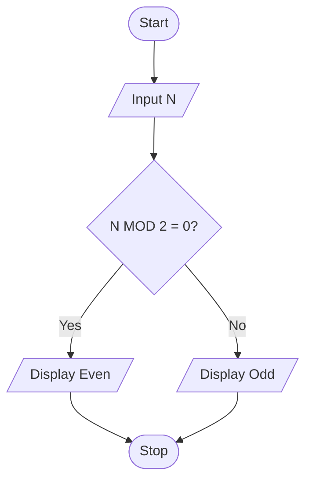

# P1.6: Even or odd

**Problem:** Input a number and display whether it is even or odd.

## Algorithm

1. Start
2. Input N
3. If the remainder of N / 2 is 0, display "Even"
4. Otherwise display "Odd"
5. Stop

## Pseudocode

```
BEGIN
    INPUT n
    IF n MOD 2 = 0 THEN
        PRINT "Even"
    ELSE
        PRINT "Odd"
    ENDIF
END
```

## Flowchart



## Dry run

N = 14: 14 MOD 2 = 0, so Even. N = 7: 7 MOD 2 = 1, so Odd.
