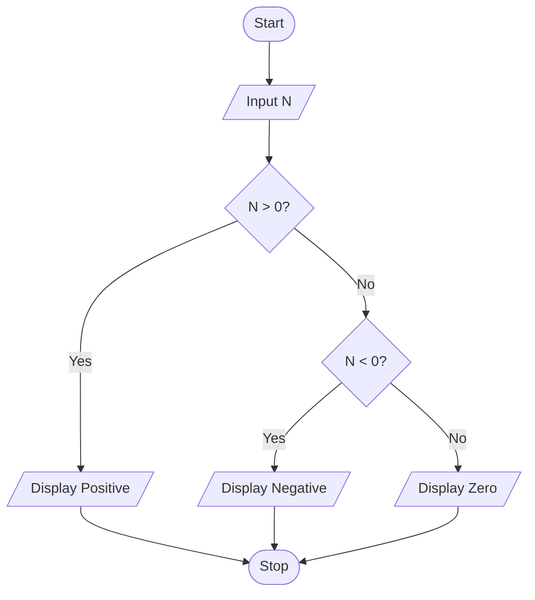

# P1.7: Positive, negative or zero

**Problem:** Input a number and display whether it is positive, negative or zero.

## Algorithm

1. Start
2. Input N
3. If N > 0, display "Positive"
4. Otherwise, if N < 0, display "Negative"
5. Otherwise display "Zero"
6. Stop

## Pseudocode

```
BEGIN
    INPUT n
    IF n > 0 THEN
        PRINT "Positive"
    ELSE
        IF n < 0 THEN
            PRINT "Negative"
        ELSE
            PRINT "Zero"
        ENDIF
    ENDIF
END
```

## Flowchart



## Dry run

N = -3: N > 0 is false, N < 0 is true, so Negative.
