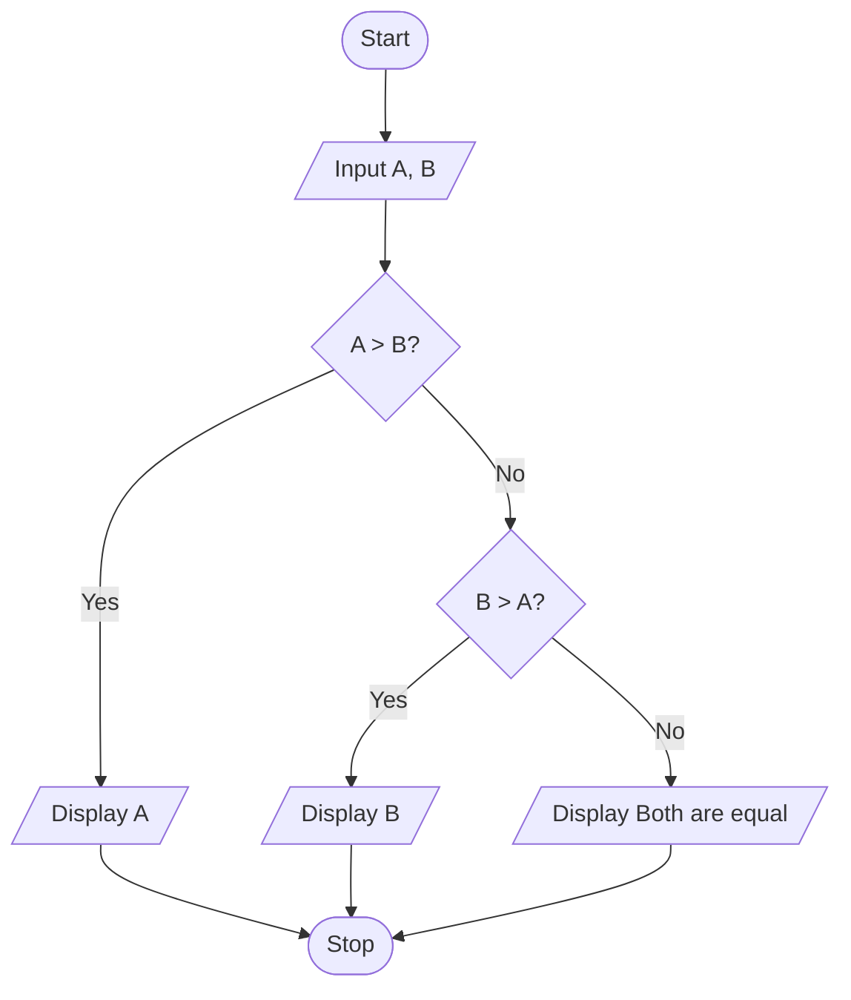

# P1.8: Larger of two numbers

**Problem:** Input two numbers and display the larger one. If both are equal, display "Both are equal".

## Algorithm

1. Start
2. Input A and B
3. If A > B, display A
4. Otherwise, if B > A, display B
5. Otherwise display "Both are equal"
6. Stop

## Pseudocode

```
BEGIN
    INPUT a, b
    IF a > b THEN
        PRINT a
    ELSE
        IF b > a THEN
            PRINT b
        ELSE
            PRINT "Both are equal"
        ENDIF
    ENDIF
END
```

## Flowchart



## Dry run

A = 25, B = 40: A > B is false, B > A is true, so 40 is displayed.
