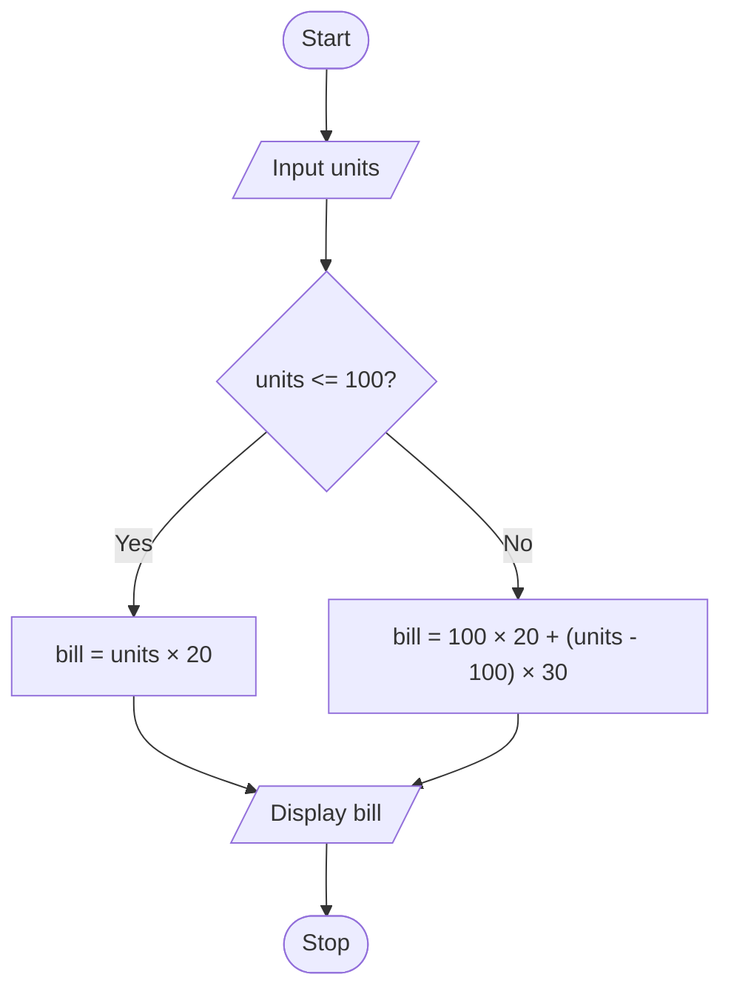

# P1.9: Electricity bill

**Problem:** Input the units of electricity consumed. Rate is Rs. 20 per unit up to 100 units, and Rs. 30 per unit above 100 units. Display the bill.

## Algorithm

1. Start
2. Input Units
3. If Units <= 100, Bill = Units × 20
4. Otherwise Bill = 100 × 20 + (Units - 100) × 30
5. Display Bill
6. Stop

## Pseudocode

```
BEGIN
    INPUT units
    IF units <= 100 THEN
        SET bill ← units × 20
    ELSE
        SET bill ← 100 × 20 + (units - 100) × 30
    ENDIF
    PRINT bill
END
```

## Flowchart



## Dry run

Units = 80: Bill = 80 × 20 = Rs. 1600. Units = 150: Bill = 2000 + 50 × 30 = Rs. 3500.
