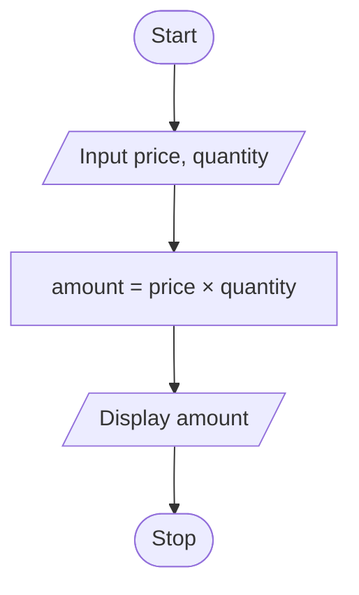

# P2.1: Cost of sugar

**Problem:** Input the price of 1 kg of sugar and the quantity bought in kg. Display the total amount.

## Pseudocode

```
BEGIN
    INPUT price, quantity
    SET amount ← price × quantity
    PRINT amount
END
```

## Flowchart



## Dry run

Price = Rs. 150, Quantity = 3: Amount = Rs. 450.

Structure used: **sequence** only.
