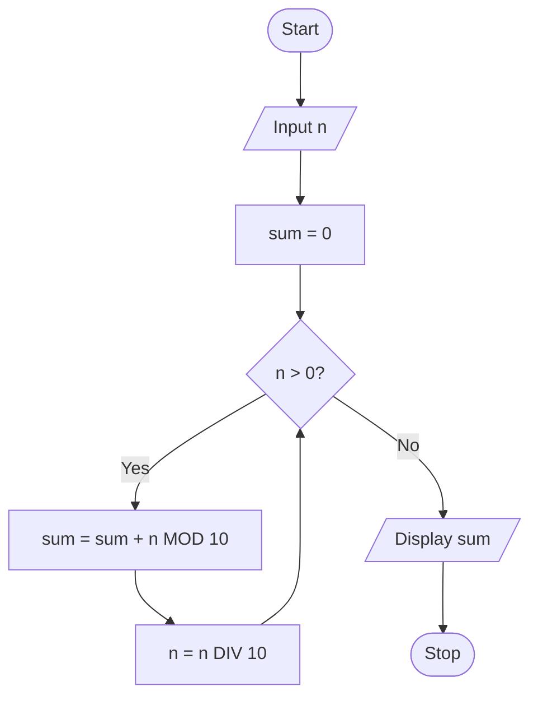

# P2.10: Sum of digits

**Problem:** Input a number and display the sum of its digits. For example, 472 gives 4 + 7 + 2 = 13.

## Pseudocode

```
BEGIN
    INPUT n
    SET sum ← 0
    WHILE n > 0 DO
        SET sum ← sum + n MOD 10
        SET n ← n DIV 10
    ENDWHILE
    PRINT sum
END
```

## Flowchart



## Dry run

n = 472: sum = 2, n = 47; sum = 9, n = 4; sum = 13, n = 0. Output: 13.

n MOD 10 gives the last digit and n DIV 10 removes it. Structure used: **condition-controlled iteration**.
