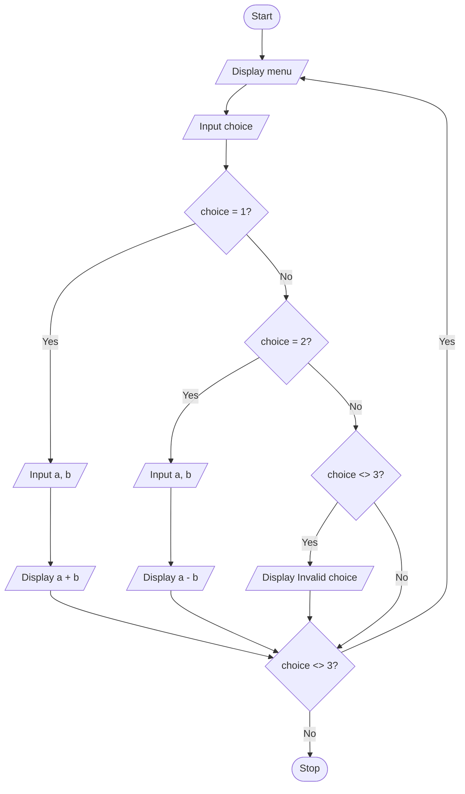

# P2.11: Menu with a post-test loop

**Problem:** Display a menu (1. Add  2. Subtract  3. Exit) again and again until the user chooses 3. Use a post-test loop.

## Pseudocode

```
BEGIN
    DO
        PRINT "1. Add  2. Subtract  3. Exit"
        INPUT choice
        IF choice = 1 THEN
            INPUT a, b
            PRINT a + b
        ELSE IF choice = 2 THEN
            INPUT a, b
            PRINT a - b
        ELSE IF choice <> 3 THEN
            PRINT "Invalid choice"
        ENDIF
    WHILE choice <> 3
END
```

## Flowchart



## Dry run

Choice 1 with 8 and 5 displays 13 and the menu appears again; choice 2 with 8 and 5 displays 3; choice 3 ends the loop.

Structure used: **post-test iteration**. The menu must be shown at least once, so the condition is tested at the end.
