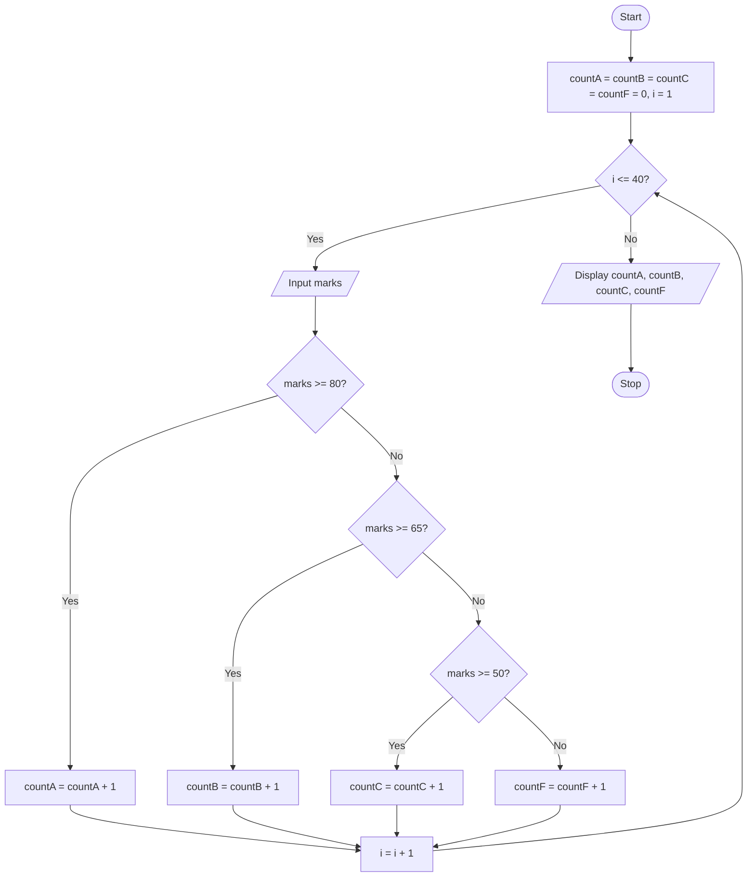

# P2.12: Counting grades

**Problem:** Input marks of 40 students. Count the students in each grade: A (80+), B (65 to 79), C (50 to 64) and F (below 50).

## Pseudocode

```
BEGIN
    SET countA ← 0
    SET countB ← 0
    SET countC ← 0
    SET countF ← 0
    FOR i ← 1 TO 40
        INPUT marks
        IF marks >= 80 THEN
            SET countA ← countA + 1
        ELSE IF marks >= 65 THEN
            SET countB ← countB + 1
        ELSE IF marks >= 50 THEN
            SET countC ← countC + 1
        ELSE
            SET countF ← countF + 1
        ENDIF
    ENDFOR
    PRINT countA, countB, countC, countF
END
```

## Flowchart



## Dry run

If the first four marks are 85, 70, 45 and 66, after four passes countA = 1, countB = 2, countC = 0, countF = 1. The four counts always add up to 40.

Structures used: **multi-way selection inside counter-controlled iteration** (Section 2.5.1).
