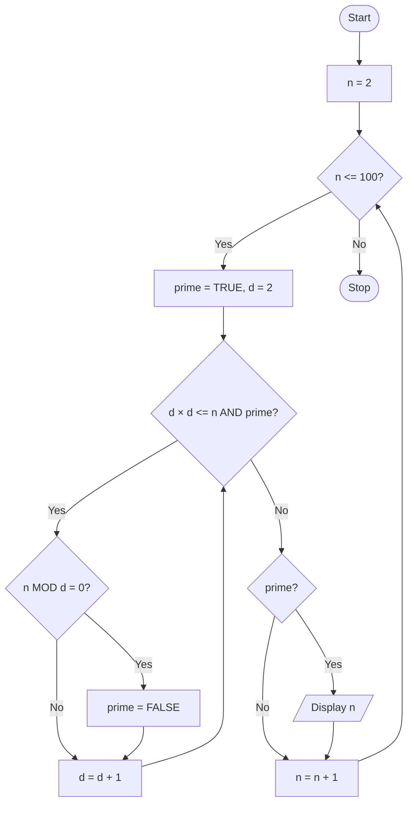

# P2.13: Prime numbers from 1 to 100

**Problem:** Display all prime numbers between 1 and 100.

## Pseudocode

```
BEGIN
    FOR n ← 2 TO 100
        SET prime ← TRUE
        SET d ← 2
        WHILE d × d <= n AND prime = TRUE DO
            IF n MOD d = 0 THEN
                SET prime ← FALSE
            ENDIF
            SET d ← d + 1
        ENDWHILE
        IF prime = TRUE THEN
            PRINT n
        ENDIF
    ENDFOR
END
```

## Flowchart



## Dry run

n = 9: d = 2 (no), d = 3 (9 MOD 3 = 0, not prime). n = 11: d = 2, 3 (3 × 3 = 9 <= 11, no), d = 4 (16 > 11, loop ends), prime. The output is 2, 3, 5, 7, 11, 13, ..., 89, 97 (25 primes).

Structures used: **iteration inside iteration** (Section 2.5.2). 1 is not a prime number, so the outer loop starts at 2. Testing divisors only while d × d <= n is enough, because a larger factor would pair with a smaller one already tested.
