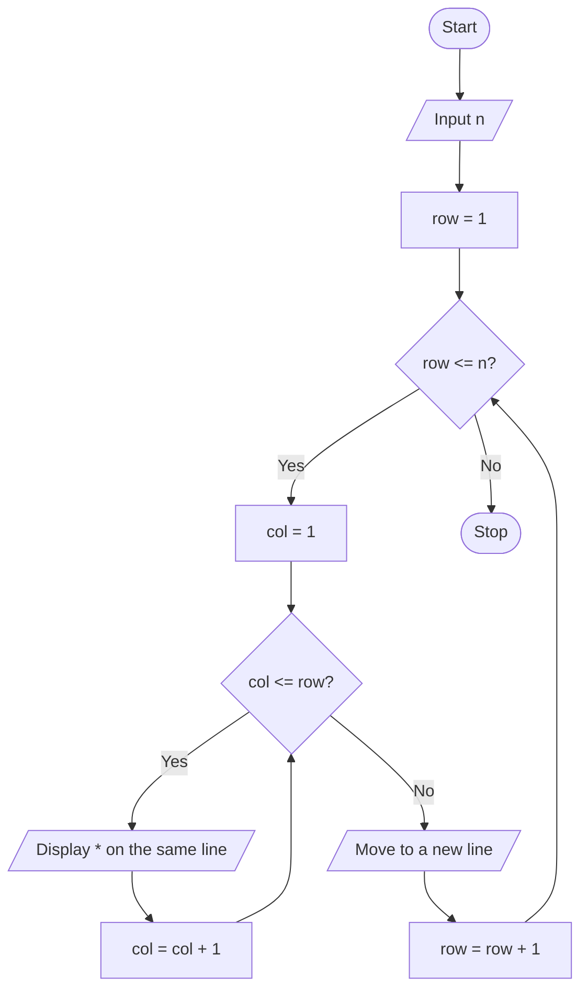

# P2.14: Star triangle

**Problem:** Print the following pattern for N rows (here N = 4):

```
*
* *
* * *
* * * *
```

## Pseudocode

```
BEGIN
    INPUT n
    FOR row ← 1 TO n
        FOR col ← 1 TO row
            PRINT "* "        // stay on the same line
        ENDFOR
        PRINT new line
    ENDFOR
END
```

## Flowchart



## Dry run

n = 4: row 1 prints 1 star, row 2 prints 2 stars, row 3 prints 3 stars, row 4 prints 4 stars.

Structures used: **iteration inside iteration**. The inner loop runs `row` times, so each row has one more star than the row before.
