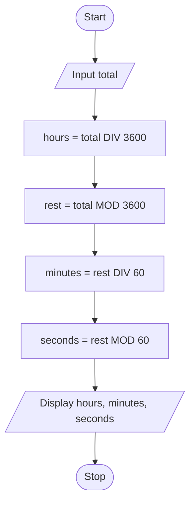

# P2.2: Seconds to hours, minutes and seconds

**Problem:** Input a time in seconds and display it in hours, minutes and seconds. For example, 3725 seconds = 1 hour 2 minutes 5 seconds.

## Pseudocode

```
BEGIN
    INPUT total
    SET hours ← total DIV 3600
    SET rest ← total MOD 3600
    SET minutes ← rest DIV 60
    SET seconds ← rest MOD 60
    PRINT hours, minutes, seconds
END
```

## Flowchart



## Dry run

Total = 3725: hours = 1, rest = 125, minutes = 2, seconds = 5.

DIV gives the whole number part of a division and MOD gives the remainder. Structure used: **sequence**.
