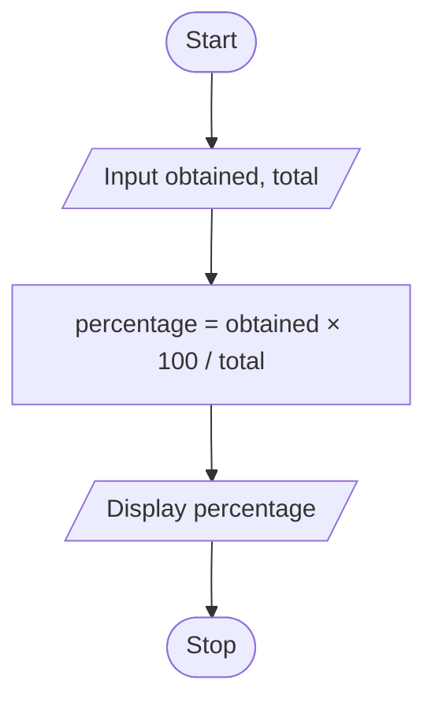

# P2.3: Percentage

**Problem:** Input the marks obtained and total marks of an exam. Display the percentage.

## Pseudocode

```
BEGIN
    INPUT obtained, total
    SET percentage ← obtained × 100 / total
    PRINT percentage
END
```

## Flowchart



## Dry run

Obtained = 412, Total = 500: percentage = 82.4.

Structure used: **sequence**.
