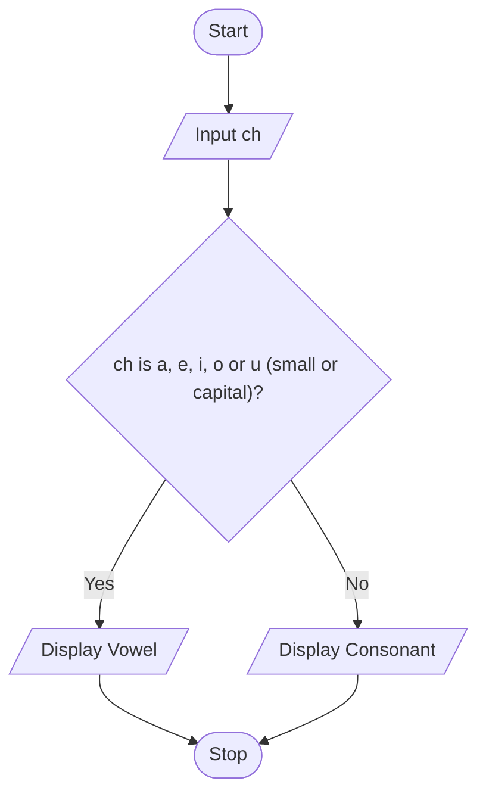

# P2.4: Vowel or consonant

**Problem:** Input a character and display whether it is a vowel or a consonant.

## Pseudocode

```
BEGIN
    INPUT ch
    IF ch = "a" OR ch = "e" OR ch = "i" OR ch = "o" OR ch = "u" OR
       ch = "A" OR ch = "E" OR ch = "I" OR ch = "O" OR ch = "U" THEN
        PRINT "Vowel"
    ELSE
        PRINT "Consonant"
    ENDIF
END
```

## Flowchart



## Dry run

ch = "E": it matches "E", so Vowel. ch = "k": no match, so Consonant.

Structure used: **two-way selection**. The solution assumes the user enters a letter; checking that the character really is a letter is left as an extra exercise.
