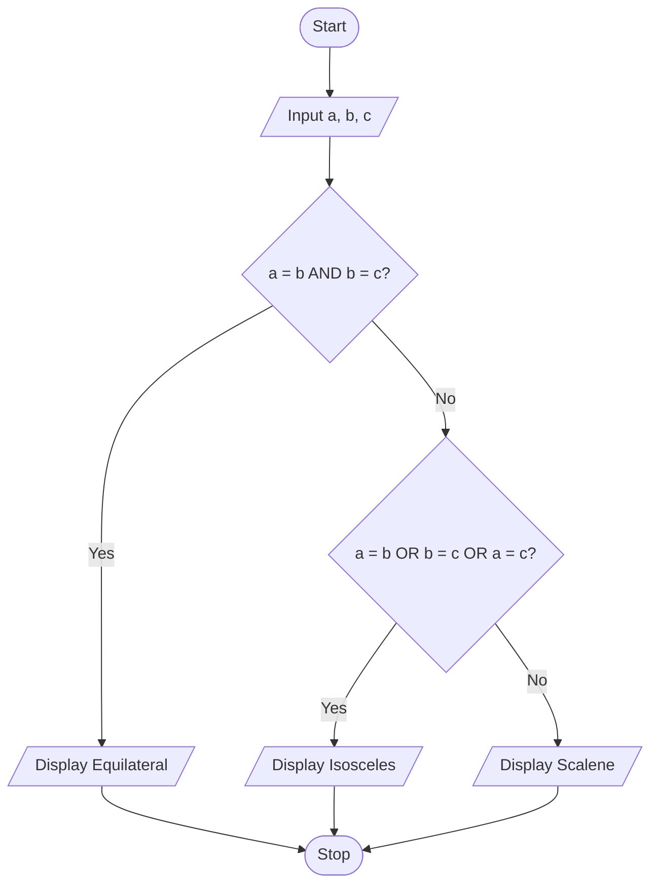

# P2.5: Type of triangle

**Problem:** Input three sides of a triangle and display whether it is equilateral, isosceles or scalene.

## Pseudocode

```
BEGIN
    INPUT a, b, c
    IF a = b AND b = c THEN
        PRINT "Equilateral"
    ELSE IF a = b OR b = c OR a = c THEN
        PRINT "Isosceles"
    ELSE
        PRINT "Scalene"
    ENDIF
END
```

## Flowchart



## Dry run

a = 5, b = 5, c = 8: first test false, second test true (a = b), so Isosceles.

Structure used: **multi-way selection**. The equilateral test must come first, because an equilateral triangle would also pass the isosceles test.
