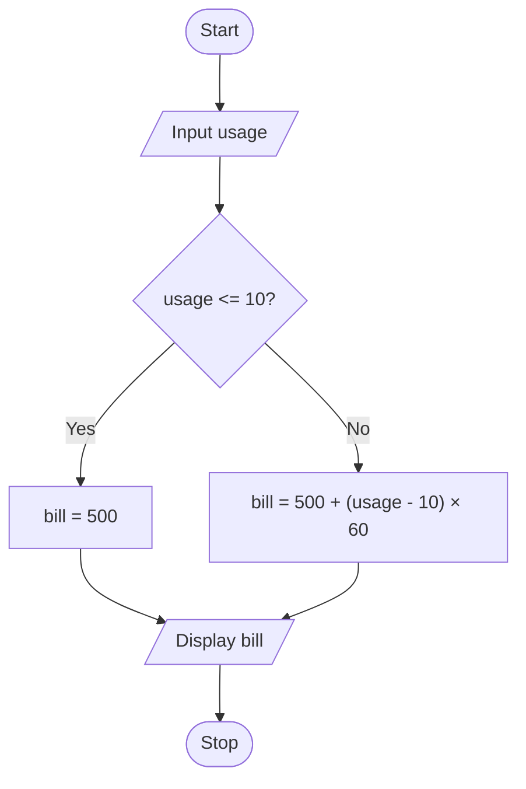

# P2.6: Mobile data bill

**Problem:** Input a mobile data usage in GB. Package A costs Rs. 500 for up to 10 GB, and each extra GB costs Rs. 60. Display the monthly bill.

## Pseudocode

```
BEGIN
    INPUT usage
    IF usage <= 10 THEN
        SET bill ← 500
    ELSE
        SET bill ← 500 + (usage - 10) × 60
    ENDIF
    PRINT bill
END
```

## Flowchart



## Dry run

Usage = 7: bill = Rs. 500. Usage = 14: bill = 500 + 4 × 60 = Rs. 740.

Structure used: **two-way selection**.
