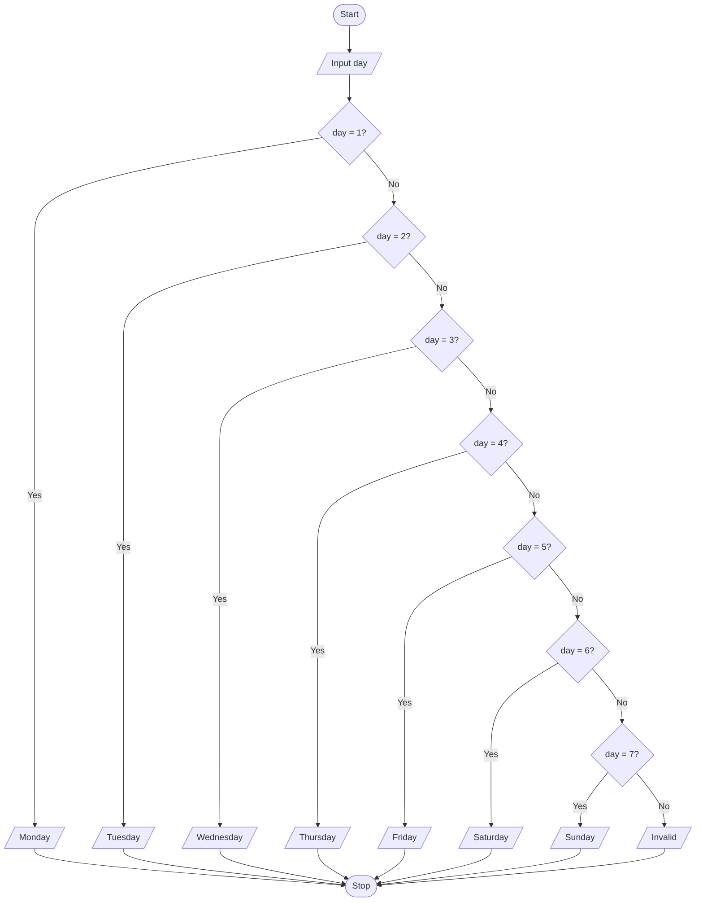

# P2.7: Day name

**Problem:** Input a day number (1 to 7) and display the day name, or "Invalid" for any other number.

## Pseudocode

```
BEGIN
    INPUT day
    IF day = 1 THEN
        PRINT "Monday"
    ELSE IF day = 2 THEN
        PRINT "Tuesday"
    ELSE IF day = 3 THEN
        PRINT "Wednesday"
    ELSE IF day = 4 THEN
        PRINT "Thursday"
    ELSE IF day = 5 THEN
        PRINT "Friday"
    ELSE IF day = 6 THEN
        PRINT "Saturday"
    ELSE IF day = 7 THEN
        PRINT "Sunday"
    ELSE
        PRINT "Invalid"
    ENDIF
END
```

## Flowchart



## Dry run

day = 5: the first four tests are false, the fifth is true, so Friday. day = 9: every test is false, so Invalid.

Structure used: **multi-way selection**. Monday is taken as day 1.
