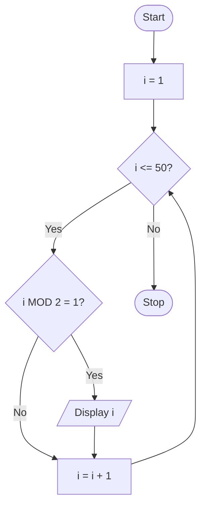

# P2.8: Odd numbers from 1 to 50

**Problem:** Display the odd numbers from 1 to 50 using a counter-controlled loop.

## Pseudocode

```
BEGIN
    FOR i ← 1 TO 50
        IF i MOD 2 = 1 THEN
            PRINT i
        ENDIF
    ENDFOR
END
```

## Flowchart



## Dry run

i = 1 (displayed), 2 (skipped), 3 (displayed), ..., 49 (displayed), 50 (skipped). The output is 1, 3, 5, ..., 49.

Structure used: **counter-controlled iteration** with **selection** inside it. Another way is to start at 1 and add 2 each time, which needs no IF.
