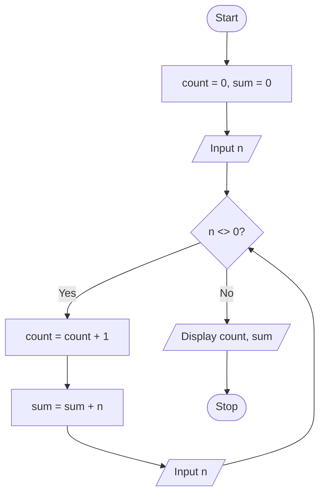

# P2.9: Count and sum until 0

**Problem:** Input numbers until the user enters 0, then display how many numbers were entered and their sum.

## Pseudocode

```
BEGIN
    SET count ← 0
    SET sum ← 0
    INPUT n
    WHILE n <> 0 DO
        SET count ← count + 1
        SET sum ← sum + n
        INPUT n
    ENDWHILE
    PRINT count, sum
END
```

## Flowchart



## Dry run

Input 12, 7, 20, 0: count = 3, sum = 39. The 0 only stops the loop and is not counted.

Structure used: **condition-controlled (pre-test) iteration** with a sentinel value, 0.
