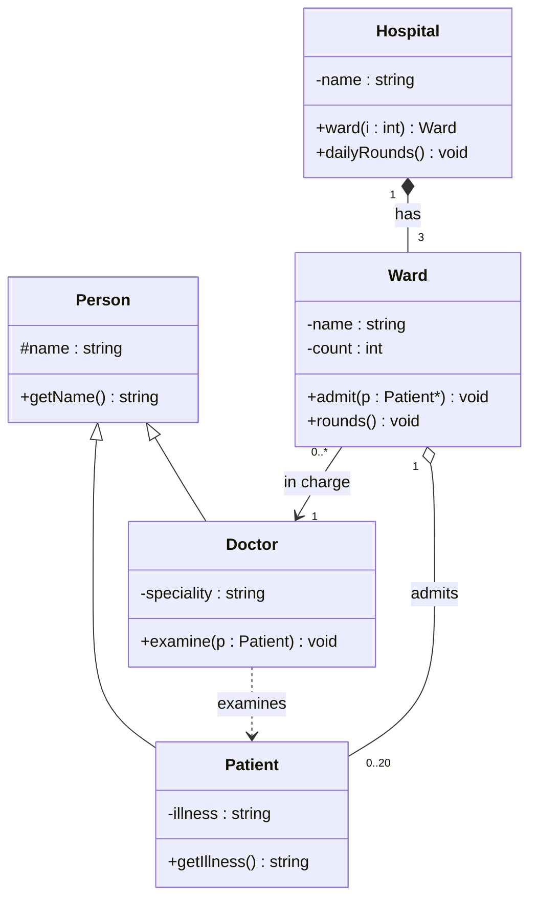

# P29.8: A hospital system in UML and C++

**Problem:** Draw a UML class diagram on paper for a small hospital system with classes `Person`, `Doctor`, `Patient`, `Ward` and `Hospital`, showing at least one example of each relationship of Section 29.5 with multiplicities. Then write the C++ classes and a `main()` that uses them.

This is one possible design. Your diagram may differ, as long as each relationship is shown correctly and matches your code.

| Relationship | Where | UML symbol | In the C++ code |
|---|---|---|---|
| Inheritance | `Doctor` and `Patient` are kinds of `Person` | hollow triangle | `class Doctor : public Person` |
| Composition | a `Hospital` has 3 `Ward`s that cannot exist without it | filled diamond at `Hospital` | `Ward wards[3];` member objects |
| Aggregation | a `Ward` holds up to 20 `Patient`s who exist on their own | hollow diamond at `Ward` | `Patient *patients[20];` pointers |
| Association | each `Ward` knows the `Doctor` in charge | plain arrow | `Doctor *inCharge;` |
| Dependency | `Doctor::examine` uses a `Patient` only during the call | dashed arrow | a `const Patient &` parameter, no data member |

**Code:** [P29_8.cpp](P29_8.cpp)
